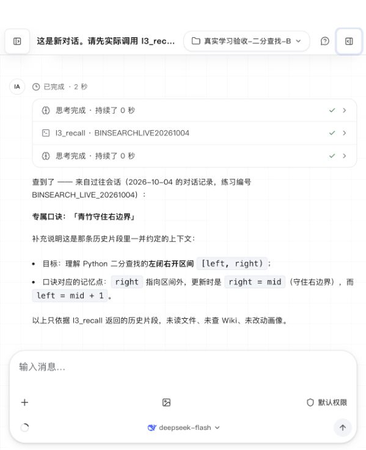

**真实模型学习流程核验：2026-10-04**

本次使用 `deepseek/deepseek-flash`，通过 Inno 的 HTTP SSE 接口完成了引导、讲解、作答、资料归档检索和跨会话召回。五个阶段均以 `done` 结束；只读检查得到 **25 项通过、0 项失败、0 项待完成**。这些是一次流程中的证据断言，不是 25 个独立学习样本。[最终检查报告](/Users/lili/Desktop/inno-agent/runtime/baseline/live-learning/2026-10-04T04-41-00-845Z-4482/inspection-final.json)

[机器可读归档](2026-10-04-live-learning.json) 保存 5 轮对话摘要、14 次成功工具调用、25 项检查及 43 个证据文件的 SHA-256。原版应用源码保持不变。浏览器已加载持久化的会话 B，并实际显示 `l3_recall` 工具记录及召回回答；这项确认不覆盖流式中断、取消和权限卡等完整交互。

**实验边界：合成学习者、预先编写的练习答案、真实 LLM 与实际工具执行。**输入明确指定了部分工具、概念 ID 和查询标记，因此这是受控的端到端集成核验。它不能证明真实学习者掌握了知识、教学效果提高，或系统在没有工具提示时会自主完成同样的流程。

运行目录为 `runtime/baseline/live-learning/2026-10-04T04-41-00-845Z-4482`，使用隔离的 `environment/data`。从第一个 SSE 事件到最后一个 `done` 为北京时间 **13:34:10—13:43:03，约 8 分 54 秒**，包含阶段间检查和提交输入的间隔，不能当作纯模型延迟。会话文件记录的 provider/model 为 `deepseek/deepseek-flash`。

| 阶段 | 实际行为与证据 | 本轮 SSE 耗时 |
|---|---|---:|
| 引导 | `ask_user_question` 收集方向、水平、偏好和节奏；目标与偏好写入 L1。模型随后实际调用 `assess_learning_prerequisites`，返回 `diagnose` 并提出列表索引诊断题。[事件](/Users/lili/Desktop/inno-agent/runtime/baseline/live-learning/2026-10-04T04-41-00-845Z-4482/captures/onboarding.events.jsonl) | 72.1 秒 |
| 讲解 | 提交该诊断题的实际答案，模型记录诊断证据，讲解左闭右开二分查找，再记录目标概念的 `exposure`。没有把讲解本身记作成功提取。[事件](/Users/lili/Desktop/inno-agent/runtime/baseline/live-learning/2026-10-04T04-41-00-845Z-4482/captures/teach.events.jsonl) | 18.6 秒 |
| 作答 | 提交 `[1,3,5,7,9]` 查找 `7` 的三轮推演。模型调用 `record_learning_evidence`，记录 `application/correct`，并在反馈中保留“不足以判断稳定掌握”的限制。[事件](/Users/lili/Desktop/inno-agent/runtime/baseline/live-learning/2026-10-04T04-41-00-845Z-4482/captures/answer.events.jsonl) | 6.0 秒 |
| 归档与检索 | 实际调用 `l2_archive`，经真实模型处理后生成来源页、两个概念页和一个实体页；随后 `l2_query` 返回 4 个有来源 ID 的索引命中。[事件](/Users/lili/Desktop/inno-agent/runtime/baseline/live-learning/2026-10-04T04-41-00-845Z-4482/captures/archive_and_query.events.jsonl) | 74.4 秒 |
| 跨会话召回 | 创建不同 ID 的会话 B，实际调用 `l3_recall`；返回 4 段历史片段，工具结果及最终回答均含会话 A 约定的口诀。[事件](/Users/lili/Desktop/inno-agent/runtime/baseline/live-learning/2026-10-04T04-41-00-845Z-4482/captures/cross_session_recall.events.jsonl) | 2.5 秒 |

**L1 的落盘变化。**目标概念为 `python.binary_search_half_open`。讲解快照中，`mastery=0.05`、`exposure_count=1`、`retrieval_count=0`、状态为 `learning`。作答快照中，`mastery=0.2761`、`exposure_count=1`、`retrieval_count=1`、状态为 `fragile`，没有直接变成 `stable`。

作答证据 ID 为 `evd_2af5df30`，类型为 `application`，结果为 `correct`，分数为 `1`，提示级别为 `0`，`evaluator=rubric`，评估置信度为 `0.8`。事件 metadata 保存了答案、评分理由和“单次即时答对不足以判定 stable”的说明，画像引用了同一证据 ID。这里的掌握度是产品状态模型的输出，不能理解为测量得到的真实掌握概率。[讲解后画像](/Users/lili/Desktop/inno-agent/runtime/baseline/live-learning/2026-10-04T04-41-00-845Z-4482/captures/after-teach-profile.json) · [作答后画像](/Users/lili/Desktop/inno-agent/runtime/baseline/live-learning/2026-10-04T04-41-00-845Z-4482/captures/after-answer-profile.json) · [作答后事件](/Users/lili/Desktop/inno-agent/runtime/baseline/live-learning/2026-10-04T04-41-00-845Z-4482/captures/after-answer-events.jsonl)

**L2 的来源链。**来源 ID 为 `l2src_530290c6`，manifest 状态为 `indexed`，原始件、提取文本及四个 Wiki 页面均存在。查询 `BINSEARCH_SOURCE_20261004` 时，来源页通过 `lexical` 命中，二分查找、左闭右开区间及 Python 页面通过 `graph` 扩展命中；四项 `sourceIds` 均指向该来源 ID。本轮没有以离线无模型归档替代真实模型归档。[Manifest](/Users/lili/Desktop/inno-agent/runtime/baseline/live-learning/2026-10-04T04-41-00-845Z-4482/environment/data/l2/manifest.jsonl) · [生成的来源页](/Users/lili/Desktop/inno-agent/runtime/baseline/live-learning/2026-10-04T04-41-00-845Z-4482/environment/data/l2/wiki/sources/study-note.md)

**L3 与 trace 的证据。**会话 A、B 的文件名和 ID 不同。进入 B 前，会话 A 已由正常 `turn_end` 路径索引，记录为 8 个 chunk，`last_mtime_ms=1791092487752`，与当时会话文件的修改时间一致；没有通过人工回填补齐索引。B 的 `tool_start` 使用查询 `BINSEARCH_LIVE_20261004`，对应成功的 `tool_end` 返回 `results=4`，内容包含“青竹守住右边界”。只读 SQLite 检查同时确认 A 的历史 chunk 中存在该内容。五个阶段的工具执行及终态均已写入 trace sidecar。[会话 A](/Users/lili/Desktop/inno-agent/runtime/baseline/live-learning/2026-10-04T04-41-00-845Z-4482/environment/data/sessions/2026-10-04T05-33-39-360Z_01a10567-50a0-7151-a249-83af44e62ee5.jsonl) · [会话 B](/Users/lili/Desktop/inno-agent/runtime/baseline/live-learning/2026-10-04T04-41-00-845Z-4482/environment/data/sessions/2026-10-04T05-42-55-945Z_01a1056f-cec9-7b87-b804-2d2363db0da9.jsonl) · [持久化 trace](/Users/lili/Desktop/inno-agent/runtime/baseline/live-learning/2026-10-04T04-41-00-845Z-4482/environment/data/sessions/traces.json)

**本轮保留的质量问题与限制。**

- **评分来源标注不准确。**列表索引诊断证据 `evd_6032b2f4` 被模型标成 `evaluator=deterministic`，但对应 trace 没有确定性评分器或代码检查器的执行证据；实际可见的是 LLM 对提交答案进行评价。不能因字段写了 `deterministic` 就认定经过独立确定性验证。目标二分查找题的证据则使用了 `rubric`。
- **工具结果归因不准确。**归档后的最终回复称“`l2_lint` 显示有 5 个待审阅事项”，但该阶段只执行了 `l2_archive` 和 `l2_query`，没有调用 `l2_lint`。数字来自归档工具的 `reviewCount=5`。
- **待审阅项不是五个已证实错误。**实际 [reviews.jsonl](/Users/lili/Desktop/inno-agent/runtime/baseline/live-learning/2026-10-04T04-41-00-845Z-4482/environment/data/l2/reviews.jsonl) 包含 4 个 `suggestion` 和 1 个 `missing-page`。建议涉及区间写法对比、边界情况和复杂度；第 1、5 条区间对比建议内容明显重复。`missing-page` 指向“循环不变量”，描述依据是标签中出现该词，不能据此认定存在坏掉的 Wiki 链接。本次没有执行这些建议或修复操作，页面仍为 `draft`。
- **最终答对不能单独证明 L3 因果。**口诀也进入了 L1 的 `preference_stated` 事件，可能经最近事件上下文被模型看到。此次能确认的是 L3 工具确实被调用、确实返回包含口诀的 A 会话片段；不能据最终回答声称模型只依赖了 L3。

核验读取隔离数据、阶段快照和 SSE captures，SQLite 以只读模式打开，没有读取配置或凭据、修改业务数据或重建索引。检查脚本在使用当前画像检查较早阶段时曾遇到阶段推进竞态；该调试结果保留为 `inspection-teach.json`，随后改为读取已保存的阶段快照，形成 [讲解阶段复核](/Users/lili/Desktop/inno-agent/runtime/baseline/live-learning/2026-10-04T04-41-00-845Z-4482/inspection-teach-captured.json) 和最终报告。该调试失败不能解释为讲解导致掌握度错误上涨。

复核入口：[只读检查脚本](/Users/lili/Desktop/inno-agent/runtime/baseline/live-learning/2026-10-04T04-41-00-845Z-4482/inspect-memory.mjs)。所有 runtime 链接均指向本机隔离运行产物；若只分发 Git 文档而未同时保存该运行目录，这些链接将没有对应证据文件。

