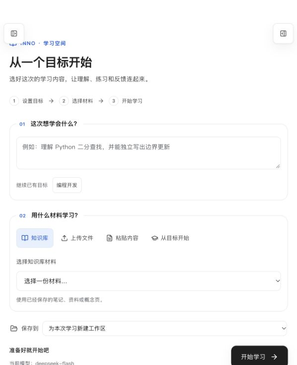

# Web 学习模式第一轮验收

2026-10-04。代码基于原版 `fc74cd6a283e8226a4307ea8c3046c715cb6e5f3`，包含上一轮证据归因修复和本轮 Web 入口改造，**不再是未修改的原版**。原始源码归档、基线和真实学习记录继续保留。

## 交付

- [使用入口](http://localhost:3100/)：设置目标 → 选择知识库、上传文件、粘贴内容或仅按目标学习 → 开始原聊天流程。
- 保留历史会话、学习状态、知识库、工作区与练习记录。目标沿用原画像接口；材料沿用原工作区上传与消息附件接口。
- 学习模式关闭渠道、subagents、MCP、todo、webAccess、computerUse，设置页只保留通用、模型与记忆。源码和原配置值保留。
- 学习消息默认展示目标摘要，可展开全文；材料附件仍可打开。创建失败保留表单，重复提交和过期导航结果不会串到其他对话。
- `experience: "full"` 并重启可恢复完整界面与原配置。旧配置缺省仍是 full，示例显式 learning。详见 [模式与回退说明](../../web-learning.md)。

## 自动回归

最终运行：`runtime/baseline/runs/2026-10-04T12-36-09-395Z-32730`，Node 24.19.0。

| 检查 | 结果 |
| --- | --- |
| Vitest | **108 文件、847 项通过，0 跳过** |
| 前后端构建 | 通过 |
| 基线工具自测 | 6 项通过 |
| 核心契约夹具 | 11 项通过 |
| 真实 HTTP / PTY 检查 | 15 项通过 |
| L2 检索夹具、SQLite/FTS5、锁文件和关键依赖 | 通过 |

本轮新增 103 项测试，覆盖模式可回退、真实 Pi 扩展注册、受限 API、教学与记忆工具保留、材料准备、失败重试、导航竞争、消息摘要和练习记录页。

第一次全量检查发现首页冷启动 500：新增模式守卫在静态请求尚未初始化配置时读取配置。两个路由处理器改为先确认路由归属，新增首页 GET、HEAD、静态 JS 三项回归后，再次完整检查通过。最终运行报告保留，首次失败报告也未删除。

## 真实学习证据

独立运行目录：`runtime/baseline/web-learning/2026-10-04T12-24-59-732Z-30428`。仅复用已配置的 DeepSeek 测试模型，使用新的合成学习数据，没有复制个人画像，也没有直接写入模拟掌握状态。

1. 通过**实际前端准备函数**调用原生产 HTTP 接口：保存目标、建立持久工作区、将粘贴的 Python 列表索引材料保存为 Markdown 附件，然后创建会话并发起 SSE 请求。
2. 模型实际调用 `record_learning_event`、`read`、`get_learner_context` 和 `assess_learning_prerequisites`。画像始终只有一个目标，声明复用 `goal_4752e711`；本次教学判断为 proceed。
3. 合成学习者回答 `colors[0]`、`colors[1]`、`colors[len(colors)]` 后，两条证据均以 **model** 来源落盘。两个概念均为 fragile，没有被判为稳定掌握。
4. 原 `create_practice_lab` 创建 `main.py` 与 `README.md`；`l2_archive` 保存模型整理的规则摘要，正文注明工作区材料路径。归档返回 2 条生成建议，工具与回答均明确没有运行 lint。
5. 经原终端 WebSocket 实际运行代码，成功记录 `run_99f848c2983a`，命令 `python3 main.py`，退出码 0，五项输出均 PASS。代码执行结果与学习者评分证据分别保留。
6. 原 `/api/runs` 可查询结果；新知识库页面可被材料准备函数选中，并继续复用原目标和持久工作区。L3 的 `index_state` 和 chunks 证明回合已进入原索引流程。

[机器可读验收报告](2026-10-04-web-learning.json)包含 12 项核验及 28 个证据文件的 SHA-256。真实模型完成 2 个回合、8 次成功工具调用。

## 浏览器与数据保留

- 已在用户原来的 3100 标签页验证：新版加载、精简导航、目标输入、原知识库材料预览、原工作区选择、学习状态与练习记录入口。
- 原环境保留两个会话。部署前后以及页面检查期间，**原报告中的 43 个证据文件 SHA-256 全部一致**。
- 两个服务在重启后、尚未读取设置前，请求首页均为 200，入口 JS 也为 200。3100 已启用 learning，L1/L2/L3 均保持开启。
- 自动化新建 3101 浏览器标签被客户端拒绝（`ERR_BLOCKED_BY_CLIENT`）。因此本次完整新学习回合采用真实准备函数 + HTTP/SSE/PTY 验收，**不声称已在浏览器点击完成整条新流程**。3101 保留独立流程数据，供继续验收。

## 明确保留的限制

- 本机只有 `python3`，原快捷运行默认 `python`。首次运行退出 127，失败记录 `run_dc9c0f65c2c7` 保留；随后使用 `python3 main.py` 成功。本轮没有安装解释器或改动系统别名。
- 本轮模型把两条 `record_learning_evidence.session_id` 错填为目标 ID，去重键也未区分会话。证据评分来源与状态有效，但**不能声称其会话关联正确**。现有 L1 接口仍接受这些参数，本轮没有改变该契约。
- 新真实回合只走 supporting 前置知识不足但可 proceed 的分支；required 前置阻断仍由已有自动测试覆盖。此次讲解没有生成 exposure 事件，不能证明曝光统计完整。
- 归档的是模型摘要，不能把正文中的材料路径当作原文件的完整来源链。本轮没有调用 `l2_query` 或 `l3_recall`，不新增“真实检索/跨会话召回已验收”的结论；此前原版召回证据继续保留。
- 上传、声明目标和代码退出 0 均不等同于掌握；保留学习者状态引擎与证据规则。
